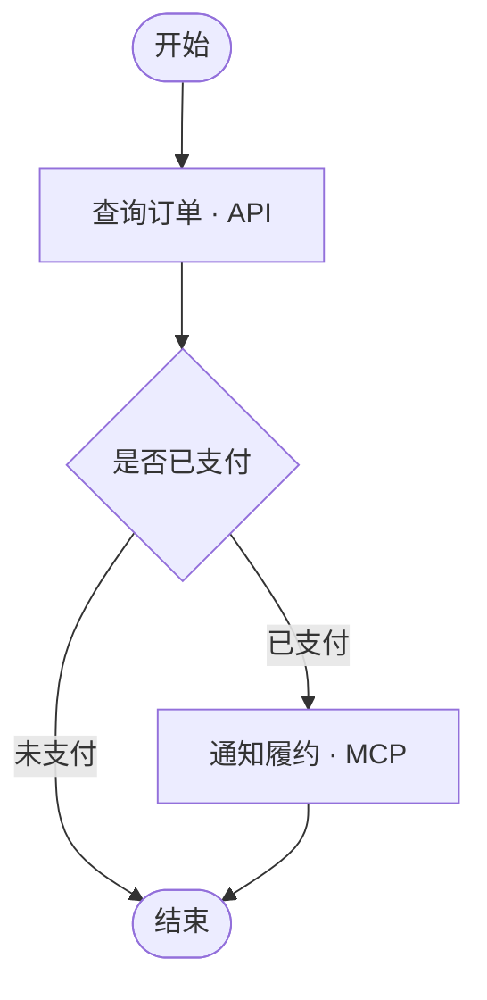

# Capability Workflow 设计

> 状态：设计提案，尚未实现。本文定义 Capability Registry 增加可视化 Workflow 编辑、确定性执行和 Agent Tool 暴露的方案。
> 当前 Capability v0.3.0 已有 MCP/API Tool 目录与 PlatformAgent HTTP 调用桥，但没有 Workflow 表、编辑器或执行器。

## 1. 目标与边界

### 1.1 目标

- 在 Capability Console 画布上添加节点、连线、分支条件，并配置节点输入/输出映射。
- 节点可以调用已启用的 Capability MCP Tool 或 API Tool；Workflow 可组合这些工具形成可复用业务流程。
- 支持等待人工提交结构化信息、确认或审批；等待期间持久化暂停，收到有效响应后从原节点继续。
- 支持工作流级和节点级前置条件、后置处理/断言、错误分支与失败策略。
- 校验通过并发布的 Workflow 以一个标准 Tool 暴露给 PlatformAgent；Agent 根据输入契约决定何时调用，Capability 按定义好的图执行完整流程。
- 保存不可变版本、执行记录和逐节点输入/输出摘要，支持测试、追踪、停用和审计。

### 1.2 非目标

- 不把 Agent 规划循环搬进 Capability；Workflow 执行不是第二个 Agent。
- 不让 LLM 在节点间决定下一步，也不支持运行时生成/修改图。
- 首版不支持任意 Python/JavaScript、Shell、自由 SQL、循环、并行分支、跨 Workflow 嵌套或任意 MCP 原语。
- 不把 Workflow 实现为 `tools` 表中的普通 `source` 值；Workflow 有版本、图结构和执行历史，应作为独立资源管理，但对 Runtime 呈现同一标准 Tool 合约。

## 2. 模块归属与执行边界

Workflow 的定义、验证、编排和节点调度都属于 **Capability 后端**。它负责调用本服务已有的 MCP/API 执行适配器。PlatformAgent / Ouroboros 只加载工作流的名称、描述和输入 JSON Schema，并将 Agent 的一次 Tool call 转发到 Capability。

```text
管理员
  │
  ▼
Capability Console（Workflow Canvas + 属性面板）
  │ Workflow REST API
  ▼
Capability Backend
  ├── Workflow Definition / Validator / Version Service
  ├── Workflow Executor（确定性 DAG 状态机）
  ├── Interaction Service / Resume Worker（待办、持久化暂停与恢复）
  ├── Tool Resolver
  ├── MCP Adapter ──► MCP Server
  ├── API Adapter ──► HTTP API
  └── PostgreSQL（definitions / versions / runs / node runs / interactions）
                         ▲
                         │ 内部 HTTP：列目录、运行 Workflow
PlatformAgent PluginLoader ──► CapabilityWorkflowTool
                         ▲
                         │ 一次标准 Tool call
                    Ouroboros AgentRuntime
```

执行规则：

1. Agent 看见每个 Workflow 是一个独立 Tool，不看见其内部节点工具。
2. Agent 的 Tool call 只提供 Workflow 输入；流程分支、工具选择、字段映射、重试和输出校验均由 Capability 固定执行。
3. Workflow Executor 在 Capability 侧调用共享的 MCP/API Tool 执行服务，不复制凭据或绕过已有 adapter。
4. 每次调用携带可关联 Platform Run 与 Capability Workflow Run 的 correlation ID。
5. 含人机交互的 Workflow 必须以持久化 Execution Job 执行：先保存上下文、待办和恢复位置，再返回等待状态并释放请求；收到响应后由 worker 恢复执行。不得让 Agent Runtime 的 HTTP 请求或数据库事务一直等待。
6. 无人机交互的短流程可同步返回；超过同步 deadline 的流程也转为 Execution Job。任何调用都不得无限占用 Runtime。

Ouroboros 已有 `FlowRunner` callable port，但当前 PlatformAgent 未配置它。该端口是框架层编排扩展点，并不意味着 Capability 需要依赖/调用业务侧 Runtime；本方案为需要复用 MCP/API 凭据与注册信息的 Capability 场景，将固定图的执行放在 Capability。

## 3. Workflow 图模型

### 3.1 节点类型

| 类型 | 用途 | 配置 |
|---|---|---|
| `start` | 唯一入口；定义输入契约 | `input_schema` |
| `tool` | 调用一个已启用 MCP Tool | `tool_id`，参数映射 |
| `api` | 调用一个已启用 API Tool | `tool_id`，参数映射 |
| `condition` | 基于执行上下文求值并选择一条出边 | 条件分支列表、默认分支 |
| `transform` | 用安全的声明式映射构建/选取/重命名字段 | `input_mapping` |
| `human_input` | 暂停流程，等待人工提交结构化信息 | 表单标题/说明、`input_schema`、截止时间、超时路径 |
| `approval` | 暂停流程，等待批准/拒绝/退回补充 | 审批标题/摘要映射、决策选项、截止时间、超时路径 |
| `end` | 唯一成功出口；返回最终输出 | `output_mapping` |

首版每个 Action 节点只执行一个已登记的 Tool。MCP/API Tool 统一以 Capability 内部 `tool_id` 解析，节点类型用于编辑器展示和校验，不允许节点提交任意 endpoint、HTTP 认证或远端 MCP 名称。

`start`/`end`、条件和转换节点不执行外部操作；`human_input` 与 `approval` 是可暂停节点，通过待办中心/API 完成人机交互。Workflow 可配置“入口/出口逻辑”，但实际由受限 mapping/assertion 表达，见 §4，不能上传脚本。

### 3.2 连线与执行规则

- 必须恰有一个 `start` 和至少一个 `end`；首版要求一个 `end`，多个完成分支需先汇入该出口。
- 图必须有向无环；从 start 可达的所有路径必须到达 `end` 或显式配置的终态失败/取消出口，不得存在孤立节点、悬空边或未处理死路。
- `tool`、`api`、`transform` 每个有一个默认成功后继；如要按结果分支，后继是 `condition` 节点。`human_input` 成功提交走默认后继，超时只能走显式 expired 边或明确的终态策略。
- `condition` 必须配置可穷尽的分支，最后一条允许为明确标记的 `default`；条件只按顺序求值，第一个匹配分支生效。
- `approval` 至少有 `approved` 与 `rejected` 两条结果边；若有 `returned`（退回补充）或 `expired`（超时）路径，必须分别显式配置。超时不得默认视为批准。
- `human_input` 的已校验表单作为该节点 `output` 提供给下游；`approval` 输出固定的 `decision` 与可选 `comment`，审批者不能提交流程游标或自定义跳转边。
- 单个条件节点只能选择一个后继。首版无并行/Join/循环，避免共享状态竞态和无限执行。
- 节点按拓扑可达的唯一下一步执行；同一节点每次 run 最多执行一次。
- 定义一个 `max_nodes`（例如 30）和 `max_edges`（例如 60）的发布校验上限，避免滥用大图。

### 3.3 定义 JSON 示例

```json
{
  "schema_version": 1,
  "input_schema": {
    "type": "object",
    "properties": {"order_id": {"type": "string"}},
    "required": ["order_id"],
    "additionalProperties": false
  },
  "nodes": [
    {"id": "start", "type": "start"},
    {
      "id": "lookup",
      "type": "api",
      "tool_id": "api-tool-uuid",
      "input_mapping": {
        "order_id": "$.input.order_id"
      },
      "preconditions": [
        {"op": "exists", "left": "$.input.order_id"}
      ],
      "postconditions": [
        {"op": "equals", "left": "$.node.lookup.output.status", "right": "ok"}
      ],
      "on_error": "fail"
    },
    {
      "id": "decision",
      "type": "condition",
      "branches": [
        {"id": "paid", "when": {"op": "equals", "left": "$.node.lookup.output.payment", "right": "paid"}},
        {"id": "other", "default": true}
      ]
    },
    {"id": "send", "type": "tool", "tool_id": "mcp-tool-uuid", "input_mapping": {"order_id": "$.input.order_id"}},
    {"id": "end", "type": "end", "output_mapping": {"status": "$.node.lookup.output.status"}}
  ],
  "edges": [
    {"from": "start", "to": "lookup"},
    {"from": "lookup", "to": "decision"},
    {"from": "decision", "branch": "paid", "to": "send"},
    {"from": "decision", "branch": "other", "to": "end"},
    {"from": "send", "to": "end"}
  ]
}
```

JSON 仅示例字段形状；服务端 Pydantic schema 和数据库 JSONB 中的 definition/version snapshot 才是验证与执行的权威版本。

## 4. 前置逻辑、后置逻辑及表达式安全

### 4.1 前置逻辑（Pre）

分两级：

- Workflow 入口 `preconditions`：验证输入范围/业务约束；不满足时以 `PRECONDITION_FAILED` 结束，不执行任何节点。
- Action 节点 `preconditions`：该节点调用前的 gate；失败策略显式选 `fail` 或 `skip_to`（只能跳向静态合法后继），不得默默跳过。

另有 `input_mapping` 用于将上下文映射成被调用 Tool 的参数。映射结果在调用远程 Tool 前按其 `input_schema` 验证。

### 4.2 后置逻辑（Post）

- `postconditions`：调用成功返回后，对结果作断言；失败即按 `on_error` 处理，默认 fail。
- `output_mapping`：提取/改名/组装 Workflow 结果；只允许声明式 JSON mapping，不求值任意代码。
- `error` 分支：Action 节点可选择静态配置的错误边，将有限的 `{code, message}` 写入上下文后转到 error handler；不得把秘密、完整认证信息或原始大响应放入错误上下文。

Workflow 出口后置检查验证最终 `output_schema`。只有通过检查才标记 run 为 `succeeded`。

### 4.3 安全表达式 DSL

条件与断言使用服务端 parser 支持的 JSON DSL，不用 `eval`、JS、模板函数或动态 SQL。建议首版仅支持：

- 比较：`equals`、`not_equals`、`gt`、`gte`、`lt`、`lte`
- 集合/字符串：`in`、`contains`、`starts_with`
- 存在性/逻辑：`exists`、`and`、`or`、`not`
- 路径读取：`$.input.*`、`$.node.<id>.output.*`、`$.workflow.*`

所有 path 编译成 JSON Pointer/token sequence，不可访问 Python 对象属性、环境变量、文件系统、网络或任意函数。限制 AST 深度、子句数、字符串/数组大小。缺失字段与 null 有不同语义；发布验证检查静态可识别的引用节点必须先于当前节点执行。

### 4.4 重试与副作用

- 每个 Action 可配置 `timeout_seconds`（硬上限）及 `retry`（次数、退避）；默认不自动重试。
- 只对已声明 `idempotent` 的操作允许自动重试。
- 写操作配置业务幂等键映射时传至执行 adapter；无幂等保障的 timeout 结果标记 `unknown_outcome`，不能盲目重放。
- 总 deadline、最大节点数、每节点重试数和外部调用总数共同限制执行预算。

## 5. 数据模型和生命周期

Workflow 是独立于现有 `tools` 表的业务资源；已发布版本锁定使用的下游 Tool 引用，但调用时仍验证这些 Tool 是 active/enabled。

### `workflows`

`id, name, display_name, description, lifecycle_state, enabled, latest_draft_version_id, active_version_id, created_by, created_at, updated_at`

### `workflow_versions`

`id, workflow_id, version_no, status, definition(JSONB), input_schema(JSONB), output_schema(JSONB), definition_hash, created_by, created_at, published_at`

`status`: `draft` → `published` → `retired`。发布版本不可原位修改；编辑已发布流程创建新 draft。Rollback 只切换 active version 指针到已发布快照。

### `workflow_runs` / `workflow_node_runs`

- Run：`id, workflow_id, workflow_version_id, status, idempotency_key, input_redacted, output_redacted, error_code, error_summary, started_at, finished_at, duration_ms, correlation_id`
- NodeRun：`id, workflow_run_id, node_id, attempt, status, input_redacted, output_redacted, error_code, error_summary, started_at, finished_at, duration_ms`
- 不存凭据或完整秘密。原始输入/输出需做大小限制和敏感字段脱敏；可配置保留期限，过期清理。
- Run 状态增加 `waiting_for_input` 和 `waiting_for_approval`；NodeRun 状态增加 `waiting`、`resumed`、`rejected`、`expired`。等待时记录 `suspended_node_id`、`resume_cursor`、`context_snapshot`、`wake_at`；通过事务保存后释放 worker。
- Runtime 调用须带稳定的 `idempotency_key`（由 run ID + tool call ID 派生）；同一 key 的重试返回原 execution 状态/结果，不重放已完成的副作用节点。无法确定执行结果时返回 `unknown_outcome` 并要求人工核查。
- 同步执行初版事务不可跨整个 Workflow 持有 DB transaction；每个状态更新短事务提交。

### `workflow_interactions`

每个待用户输入/审批节点生成一条 durable interaction：

`id, workflow_run_id, node_id, kind, status, title, prompt, form_schema, display_data, decision_schema, response, response_comment, created_at, due_at, completed_at, completed_by, revision`

- `kind`: `input` / `approval`；`status`: `open` / `submitted` / `approved` / `rejected` / `returned` / `expired` / `canceled`。
- Workflow Run 与 Interaction 分表；Interaction 只存交互所需的已脱敏显示数据和结构化响应，不复制整个运行上下文。
- 一个暂停点一个 interaction；恢复后到下一个暂停点再新建一条。`revision` + 条件更新保证并发提交只接受一个终态响应；重复提交返回已完成状态，不重复恢复流程。
- 人工响应与超时 worker 竞争时，均以 `status=open` 和当前 `revision` 做原子条件更新；由先成功提交的一方决定结果，另一方读取并返回最终状态，不得双重恢复。
- Worker 按 `due_at` 扫描超时项，应用定义中的 `on_expire`（显式错误、expired 边或取消），绝不自动批准。恢复任务通过持久化队列/DB claim 执行，进程重启后可继续。
- 保留 `context_snapshot` 时加密/脱敏并限制访问与保留期；只存恢复所需字段，避免把凭据或不必要的个人信息放入快照。

### 暂停与恢复状态流

```text
queued → running → waiting_for_input ──submit──→ running → … → succeeded
                           └─ deadline → expired edge / failed / canceled

running → waiting_for_approval ──approve──→ running
                    ├─ reject → rejected edge / failed
                    ├─ return → configured input node
                    └─ deadline → expired edge / failed / canceled
```

审批拒绝不是“异常”本身：它可以沿 `rejected` 分支走到通知/结束节点；只有流程定义明确选择 fail 时才把 Run 终结为 `failed`。`returned` 必须指向图中下游静态配置且已验证的 `human_input` 节点或后继，以维持 DAG；不允许提交者指定任意跳转位置。每次恢复前校验 Run 仍处于对应 waiting 状态，并原子写入响应、NodeRun 结果和下一执行游标。

内部 Workflow Tool 以 `workflow_id + active_version` 装配为 manifest：

```json
{
  "identity": {"name": "fulfill_order", "display_name": "履约订单", "version": "2"},
  "provider": {"kind": "workflow", "workflow_id": "workflow-uuid"},
  "metadata": {"description": "校验订单并执行履约流程"},
  "contract": {
    "input_schema": {"type": "object", "properties": {"order_id": {"type": "string"}}},
    "output_schema": {"type": "object"}
  }
}
```

这是 Runtime 目录中的 projection，不要求将 Workflow 混存到现有 Tool 表。

## 6. Console 交互设计

### 6.1 导航与列表

新增 **Workflows** 导航项和列表页：名称、版本、草稿/发布状态、启停、最后编辑/发布人、最近执行结果；支持创建、复制、编辑、发布、停用、运行记录。

### 6.2 Workflow 编辑器

#### 原型布局

```text
┌─────────────────────────────────────────────────────────────────────────────────────────────┐
│ ‹ Workflows / 履约订单   Draft v3 · 未保存                                                   │
│ [撤销] [重做] [自动布局] [验证] [试运行]                    [保存草稿] [发布 ▾]             │
├──────────────────┬───────────────────────────────────────────────┬──────────────────────────┤
│ 添加节点          │ 画布  [－] 100% [+] [适应画布] [小地图]       │ 节点配置                 │
│                  │                                               │                          │
│ + 开始            │    ┌─────────────┐                            │ 查询订单 · API            │
│ + Tool            │    │ ① 开始       │                            │ 工具  [选择已发布 API ▾] │
│ + API             │    │ 输入: order_id│                           │                          │
│ + 条件            │    └──────┬──────┘                            │ 输入参数映射             │
│ + 转换            │           │                                   │ order_id ← input.order_id│
│ + 人工输入        │                                               │ 表单 Schema / 截止时间 │
│ + 人工审批        │                                               │ 审批摘要 / 结果分支     │
│ + 结束            │           ▼                                   │                          │
│                  │    ┌─────────────┐       成功                  │ 前置条件   [+ 添加]     │
│ 拖到画布添加节点  │    │ ② 查询订单   ├──────────────────┐         │ 后置断言   [+ 添加]     │
│                  │    │ API · 2.1s   │                  │         │                          │
│                  │    └──────┬──────┘                  ▼         │ 超时 30s   重试 关闭    │
│                  │           │                    ┌─────────────┐ │                          │
│                  │           │                    │ ④ 通知履约   │ │ 错误策略 [失败终止 ▾]   │
│                  │           ▼                    │ Tool · MCP  │ │                          │
│                  │    ┌─────────────┐   已支付     └──────┬──────┘ │ [删除节点]              │
│                  │    │ ③ 是否已支付 ├─────────────────────┤         │                          │
│                  │    │ 条件         │                     │         │                          │
│                  │    └──────┬──────┘ 未支付              │         │                          │
│                  │           └─────────────────────┐       │         │                          │
│                  │                                 ▼       ▼         │                          │
│                  │             ··· ⑥ 等待审批 ···                    │                          │
│                  │                          ┌─────────────┐          │                          │
│                  │                          │ ⑤ 结束       │          │                          │
│                  │                          │ 输出: status │          │
│                  │                          └─────────────┘          │                          │
├──────────────────┴───────────────────────────────────────────────┴──────────────────────────┤
│ 校验结果：✓ 5 个节点  ✓ 5 条连线  ⚠ “未支付”分支直接结束                                   │
└─────────────────────────────────────────────────────────────────────────────────────────────┘
```

节点用圆角矩形表示，节点边缘显示连接端口；连线带箭头表示执行方向。选中节点后画布高亮其上下游边，
右侧属性面板显示该节点配置；画布底部常驻显示错误和警告，点击结果可定位到对应节点/连线。
上方线框用于表达编辑器布局和节点端口交互；示例流程的准确分支关系如下：



#### 添加、连线与编辑交互

- 左侧节点面板点击节点即可添加到视口中心，拖放则放在落点；`start` 默认创建且唯一，不能重复添加。
- 从节点的**输出端口**拖到另一个节点的**输入端口**创建有向连线；悬停目标端口高亮，松开后连线吸附端口。
- 从空白输出端口松开时弹出“创建后继节点”菜单（Tool/API/条件/转换/结束）；选中后自动创建节点并连线。
- Condition 节点每个分支有独立输出端口，端口旁显示分支名（例如“已支付 / 未支付 / 默认”）；每个分支只能连接一个后继。普通节点只有一个成功输出端口；配置错误边时显示单独的 error 端口。
- 点击连线选中并显示边标签；双击条件边可编辑分支标签，按 Delete/Backspace 删除选中的节点或连线。删除节点时询问是否一并删除关联连线，不自动跨接前后节点。
- 拖动节点只改变草稿布局坐标，不改变运行顺序；“自动布局”按图方向重排，布局位置与执行语义分离。
- 节点复制生成新 ID，不复制已发布状态；复制的 Tool/API 引用和字段映射保留，但需重新校验。
- 支持画布缩放、平移、框选、多选删除、撤销/重做和适应画布；缩略图显示全图及当前视口。

#### 右侧属性面板

未选中节点时显示 Workflow 属性（名称、说明、输入/输出 Schema、入口前置条件、总 timeout）；选中节点后按类型切换字段：

| 节点 | 属性面板内容 |
|---|---|
| 开始 | 输入 Schema、入口前置条件 |
| Tool / API | Capability Tool 选择器、Schema 参数映射、前置条件、后置断言、错误策略、超时/重试 |
| 条件 | 条件表达式行、分支名、默认分支开关；提供“新增分支”并为每个分支创建独立输出端口 |
| 转换 | 基于 Context 字段树的输出映射 |
| 人工输入 | 标题/说明、表单 JSON Schema、截止时间、超时路径 |
| 人工审批 | 审批摘要映射、批准/拒绝/退回选项、截止时间、各结果路径 |
| 结束 | 最终输出映射、Output Schema、出口后置断言 |

每个字段映射支持从左侧输入/上游节点输出字段树拖入，生成受限 JSON path；也可通过 DSL 条件构造器选择运算符，
不用用户手写任意代码。节点执行失败策略须明确显示（终止、转错误路径或配置的 skip），不能隐藏在高级配置中。

#### 图例与验证反馈

| 视觉状态 | 表示 |
|---|---|
| 蓝色节点 | 尚未运行 / 正常 |
| 绿色节点与实线 | 最近一次试运行成功 |
| 红色边框/连线 | 配置或执行错误 |
| 黄色标记 | 可发布但需确认的 warning |
| 旋转图标 | 试运行中 |
| 虚线边 | 错误处理路径（若启用） |

验证运行后列出 `error/warning + 节点/边 ID + 修复提示`。点击一条结果会把目标滚动到视口中心并打开属性面板；
存在 error 时禁用发布按钮，warning 不阻止发布但要求显式确认。

#### 原型结构草图

```text
左：节点面板       中：有向图画布             右：所选节点属性
Start / Tool / API / Condition / Transform / End
                 zoom / pan / auto-layout       配置、输入输出、条件、错误策略
```

- Tool/API 节点选择 Capability 已发布且启用的 Tool。打开工具 schema 作为右侧输入字段提示，不允许在 Workflow 中编辑远端凭据。
- 属性面板用字段树/表达式 builder 配置 `input_mapping`、preconditions、postconditions、错误策略、timeout/retry。
- 画布用颜色/图标区分 start/end/action/condition/transform；验证错误定位到节点/连线，显示具体原因。
- 节点面板和字段选择器提供 test-run 样例输入、输出模拟；运行态显示每个节点排队/运行/成功/失败状态，点击查看脱敏的输入/输出及耗时。
- 画布增加“人工输入”和“人工审批”节点。交互节点暂停后显示“等待输入/等待审批”、待办数量与截止时间；恢复后显示响应结果和处理耗时。
- 提供独立的“待办中心”：列表按待处理/已处理/已过期分组，详情显示发起流程、流程摘要、当前节点、脱敏业务上下文和截止时间；输入待办渲染 JSON Schema 表单，审批待办提供批准、拒绝、退回补充及可选说明。
- 提交前展示决定及后续分支提示；成功提交后禁用再次操作并显示处理状态。网络重试应安全返回当前待办状态，不重复推进 Workflow。
- 首版不引入新画布包时可先用轻量 SVG/HTML 画布；若使用 React Flow，应评估其 license、React 版本适配、键盘可访问性和 bundle 后再纳入依赖。画布组件不是执行引擎。

### 6.3 编辑体验规则

- 自动保存只保存 draft；发布一定由用户明确确认，并显示版本差异与影响到的 Agent 绑定。
- 另存为新版本，不覆盖正在执行的 run 读取的版本快照。
- 发布失败时展示节点级 errors；warnings（如无失败分支、仅输出部分字段）要求确认。
- 删除被 active Agent 绑定的 Workflow 前必须先禁用/解绑；保留历史 run 及对应版本快照。
- 保存或发布时验证人工输入的 Schema、审批结果端口、退回目标及超时行为均已配置；画布不能把人工节点表现为普通同步 Tool。

## 7. API 设计草案

Management API 为 Workflow 的管理、测试和版本操作提供接口；内部 Runtime API 提供 Workflow 清单和运行入口。
接口访问控制及调用主体验证要求统一见文末“权限与安全治理”。

| Method / Path | 用途 |
|---|---|
| `POST /workflows` | 创建 Workflow 与初始 draft |
| `GET /workflows` | 分页列表/过滤 lifecycle |
| `GET /workflows/{id}` | 获取元数据和版本指针 |
| `PUT /workflows/{id}/draft` | 保存 draft definition（带 `revision` 乐观锁） |
| `POST /workflows/{id}/validate` | 服务端结构、引用、schema、DAG、静态表达式校验 |
| `POST /workflows/{id}/test-runs` | 管理员试运行 draft，必须提示会真实调用下游 API/MCP 并可能产生副作用 |
| `POST /workflows/{id}/publish` | 再验证并生成不可变发布版本 |
| `POST /workflows/{id}/rollback` | 将 active pointer 切回某已发布版本 |
| `POST /workflows/{id}/enable` / `disable` | 启用/停用 Agent 暴露 |
| `GET /workflows/{id}/runs` | 查询运行记录 |
| `GET /workflow-runs/{run_id}` | 查询整体状态、结果和节点 trace |
| `GET /workflow-runs/{run_id}/interactions` | 查询该 Run 的待办及交互状态 |
| `GET /interactions` | 待办中心查询待处理/已处理项 |
| `GET /interactions/{interaction_id}` | 获取待办详情及表单/审批摘要 |
| `POST /interactions/{interaction_id}/submit` | 提交结构化表单；以 interaction ID + revision 做幂等并发控制 |
| `POST /interactions/{interaction_id}/decide` | 提交 `approve`、`reject` 或 `return` 决定及说明 |
| `GET /internal/workflows` | 返回 enabled/published 的 Workflow Tool manifests（服务间认证） |
| `POST /internal/workflows/{id}/call` | Runtime 执行 active Workflow（服务间认证及调用上下文） |
| `GET /internal/workflow-runs/{run_id}` | PlatformAgent 查询 pending Run 的当前状态与最终结果 |

运行 API 接口 body 使用 `{ "arguments": {...}, "context": {...} }`；调用方不能提交 graph definition、tool_id 列表或 override version。下游工具解析必须以服务端发布快照为准。

交互提交只接受当前 interaction 的 `form_schema` 或 `decision_schema` 所定义的数据，不接收恢复游标、目标节点或执行上下文。写入交互响应与 enqueue/resume 标记必须原子提交；API 快速返回当前 interaction/Run 状态，恢复执行由 worker 完成。
运行调用在同步完成时返回最终结果；创建或进入持久化等待时返回 HTTP `202` 和 pending 状态。交互完成后，调用方通过 Run 状态查询或通知获取最终结果，不复用原始 HTTP 请求。

## 8. PlatformAgent / Agent 接线

1. Capability 内部目录返回 `kind: "workflow"`、稳定 workflow ID、manifest 和 active version。
2. PlatformAgent 扩展 PluginLoader 的明确引用类型，例如 `{ "type": "capability_workflow", "ref": "<workflow UUID>" }`；不默认把所有 Workflow 自动暴露给 Agent。
3. 新增 `CapabilityWorkflowTool`，沿用 Tool 的 name/description/parameters/run 契约；执行时只 POST workflow ID 与参数到 Capability 内部 API。
4. Agent 的 system/tool description 明确其调用会启动一整套预定义业务步骤，说明输入、输出和潜在等待。
5. 不含交互且在同步 deadline 内完成时，Tool 返回最终结果；到达 `human_input` / `approval` 节点或超出同步 deadline 时，返回结构化 `pending`，包含 `workflow_run_id`、`interaction_id`（若存在）、`status`、用户可读提示及状态查询标识，不将 Tool call 保持为未完成请求。
6. PlatformAgent 可将 pending 结果转述给用户；人类提交后由 Capability 恢复 Workflow。恢复完成后通过状态查询或事件通知读取结果。此机制本身不恢复原始 LLM turn，也不保证 Agent 自动继续推理；若要自动续跑对话，应另行设计带幂等与授权校验的 Platform 回调/续跑机制。
7. 每次调用传递/记录 run correlation ID；Capability 返回 workflow run ID 和结构化结果，Platform 的 ToolResult 中应保留此 ID 供后续诊断。完整 node trace 不塞入模型上下文，只把有界业务结果返回 Agent。
8. 失败以结构化 `{success:false, error:{code,message}, workflow_run_id}` 返回；不要把异常伪装成成功，也不要把堆栈、凭据或远端原始秘密交给模型。

等待状态的 ToolResult 示例：

```json
{
  "success": true,
  "status": "pending",
  "workflow_run_id": "wrun_...",
  "interaction_id": "wint_...",
  "message": "需要补充订单信息，提交后流程将继续",
  "status_url": "/workflow-runs/wrun_..."
}
```

`success: true` 表示 Workflow 已成功启动并进入待办状态，不代表业务流程已完成；最终业务结果仍以 Run 终态为准。Platform 对用户提供待办链接/通知和结果查询入口，避免要求 Agent 在原 Tool call 中等待。

## 9. 迭代实现建议

### Phase A：可视化顺序 Workflow

- Workflow/Version CRUD、draft JSON、revision 乐观锁、发布与基本 Validator。
- Start → Tool/API/Transform → End；声明式 input/output mapping 和 schema 校验。
- 内部 Workflow Tool manifest/call bridge；PlatformAgent 显式绑定为单个 Tool。
- 同步 bounded executor、run/node trace、测试运行与失败显示。

### Phase B：分支与逻辑

- Condition 节点、表达式 DSL、静态引用分析、pre/postconditions、默认分支和错误边。
- 幂等配置、有限重试、发布依赖差异和静态引用分析。
- Console 分支 builder、错误定位和执行路径高亮。

### Phase C：异步与生产治理

- 持久化 job/worker、claim lease、重启恢复、取消语义和查询接口；这是人机交互上线的前置阶段。
- 依赖变更通知、执行记录保留策略、并发限额、指标及运行告警。

### Phase D：人机交互

- 首期支持 JSON Schema 表单输入、单次批准/拒绝/退回、截止时间和显式超时路径；交互节点均使用持久化暂停/恢复。
- 实现 Interaction/待办 API、待办中心 UI、并发幂等提交、超时扫描和重启恢复集成测试。
- 多级/并行审批、委托/转交、动态审批链、任意暂停点编辑及自动恢复原 Agent 对话不纳入首期。

## 10. 验收测试

- **Definition/Validator**：缺失 start/end、循环、孤立节点、不可达 end、重复 ID、悬空 Tool ID、已禁用 Tool、未定义 branch、错误 path 和输出 schema 均拒绝发布。
- **Execution**：顺序节点输出可被后续节点引用；条件只选一条边；default 正确；precondition fail 时不调用外部 Tool；postcondition fail 时 run 失败或走显式错误路径。
- **Versioning**：运行中发布新版本不影响旧 run；失败发布不切活动版本；rollback 仅选择 published revision。
- **Failure**：节点超时、远端 4xx/5xx、JSON 不匹配、worker/API 异常均留下 node trace 与明确状态；unknown outcome 不自动重复写操作。
- **Human interaction**：表单 Schema 校验、审批批准/拒绝/退回路径、超时路径、重复/并发提交仅生效一次；暂停后释放请求，worker 重启后可恢复；Tool 返回 pending 而不是挂起 Agent 请求。
- **Security**：Agent 不能覆盖图定义、tool_id、endpoint 或 version；执行数据不能注入流程定义或表达式执行。
- **Bounds**：循环图不能发布；最大节点、最大输出、最大重试和 deadline 均被验证；大结果不会无限进入 LLM 上下文。
- **E2E**：创建草稿 → 拖入 API/MCP Tool 节点 → 条件分支 → 校验/试跑 → 发布 → PlatformAgent 绑定 → Agent 调用并取得同步结果（无人工等待场景）→ 管理端可追踪 workflow/node run。
- **Human E2E**：Agent 调用返回 pending → 用户在待办中心提交/审批 → worker 恢复执行 → PlatformAgent 查询/收到通知并取得最终结果。
- **真实集成**：使用测试 MCP Server 和 Mock API 测试完整 Registry/Runtime 路径；FakeSession 单测不能替代 HTTP、事务和并发集成测试。

## 11. 关键决策总结

| 问题 | 决策 |
|---|---|
| Workflow 放哪个模块执行？ | Capability Backend；共享其已保存的 Tool 配置与凭据 |
| Workflow 在 Agent 看来是什么？ | 一个有输入/输出 schema 的标准 Tool |
| Agent 如何选内部节点？ | 不选择；Agent 只决定是否调用已绑定的 Workflow |
| 如何配置前置/后置逻辑？ | JSON DSL、mapping、assertion，不允许任意脚本 |
| 怎么防止流程被调用参数篡改？ | Agent 不能提交或覆盖 Workflow graph、Tool ID、endpoint 或发布版本 |
| 怎么做分支？ | 有向无环图上的 Condition + 穷尽分支/default；无循环、无并行（首版） |
| 如何暂停等待人工？ | 持久化 Interaction 与恢复游标，释放请求，由 worker 在提交后恢复 |
| Agent Tool 在等待时如何返回？ | 结构化 pending；不占住 Runtime 请求，也不隐式恢复原 LLM turn |
| 是否直接借用 Ouroboros FlowRunner？ | 不作为 Capability 执行后端；它是另一层可选端口，本方案需要 Capability 侧凭据与 adapter |

## 12. 权限与安全治理

本节集中定义 Workflow 的身份、授权、权限继承和执行安全要求。Capability 当前 Provider/Tool 管理没有用户登录或 RBAC；增加可执行 Workflow 前，不能把编辑器隐藏、共享集成密钥或 MCP Tool 的声明信息当作完整授权机制。

### 12.1 身份与授权边界

- **管理 API**：创建、编辑、试跑、发布、回滚、启停和查看执行记录必须由登录主体和 RBAC 保护。Capability 管理 API 目前尚无此能力，是 Workflow 正式上线的前置条件。
- **Runtime API**：PlatformAgent 到 Capability 使用服务间身份认证。共享集成 key 只能证明请求来自受信任服务，不能单独代表终端用户或授权调用任意 Workflow。
- **调用上下文**：生产级调用需验证并传递 tenant、user、agent、run 与 scopes；建议使用带 audience、有效期和重放保护的签名短期凭据，并写入审计记录。
- **Workflow 绑定**：Agent 只可调用明确绑定给它、已启用且有 published active version 的 Workflow；调用方不可自行选择旧版本、修改 graph 或覆盖 Tool ID、endpoint。
- **资源范围**：schema 首版预留 `tenant_id`；清单、执行记录查询及运行调用均校验 tenant 与 Workflow 资源范围，防止跨租户读取或执行。
- **下游依赖**：发布时保存依赖 Tool 列表；发布校验和运行时均复核引用的 MCP/API Tool 仍处于 active/enabled。Workflow 不得提高下游 Tool 权限或绕过 Tool 级授权。
- **权限传播**：Workflow manifest 应显示其依赖节点中的最高风险/权限级别；节点级权限在实际调用时逐个执行。拥有 Workflow 调用权不能隐式获得下游未授权能力。
- **人机交互授权**：待办列表、交互详情、表单提交、批准/拒绝/退回、取消和执行记录查询均须按租户及资源范围授权；记录实际响应主体、决定、时间和说明，并纳入审计。具体允许哪些用户/角色处理待办由组织策略配置，不能由 Workflow 输入参数自行指定。
- **审批分离**：对于高风险副作用，可配置“发起者不得审批本人发起的 Run”、至少一名/多名审批人等策略；策略在服务端强制执行并在发布时校验，不能由画布提示或 Agent 自述替代。低风险流程可按组织策略不要求审批。
- **副作用与人工审批**：含写入、删除或其他破坏性操作的 Workflow 必须显式标记风险，并由授权策略要求相应 write scope/审批。MCP annotations 仅作提示，不作为授权凭据；人工审批节点只提供业务决定记录，不能替代下游 Tool 的授权检查，也不能自动批准副作用重试。
- **Agent 可见性**：Agent 只收到经授权的 Workflow Tool schema 和结果，不接收下游凭据、内部网络地址或执行环境变量。

### 12.2 执行安全与数据保护

- 条件 DSL 使用固定 parser；禁止 `eval`、动态 import、Shell、自由 SQL、文件路径、隐式 HTTP 或访问环境变量。
- JSON path 只读取受控 Workflow Context；限制表达式深度、子句数、字符串/数组大小。
- 设置 Workflow 总 timeout、每节点 timeout、最大节点/调用/重试数与输入输出体积上限。
- 自动重试只适用于明确声明幂等的调用；写操作无幂等键时遇到不确定结果标记 `unknown_outcome`，禁止盲目重放。
- 日志、执行记录、错误响应及传给模型的结果需脱敏并限长。凭据仅留在 Capability adapter，不放入节点上下文或 Agent Prompt。
- 运行时 Tool 输出视为不可信数据，不能改变 Workflow graph、授权规则或工具配置；所有外部操作仍通过 Capability 的既有 MCP/API adapter 完成。
- Management Auth/RBAC、tenant scope、Tool 调用授权和审计是执行 Workflow 的上线前置；不可用界面隐藏或仅有服务间共享密钥代替用户/租户授权。
