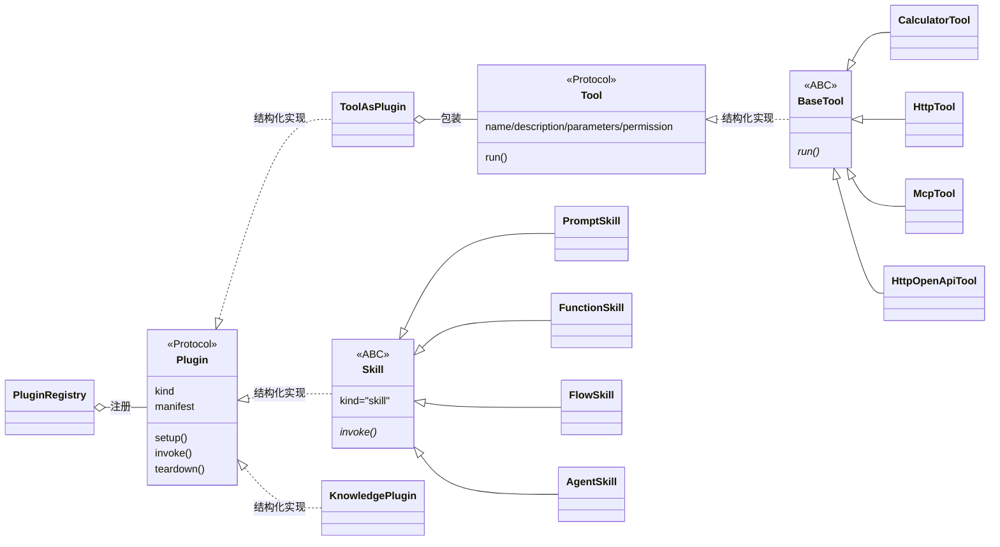

# Ouroboros 架构总结

> 适用版本：Ouroboros 2.0.0（导入包名 `ouroboros`）。本文基于 `application/ouroboros/ouroboros/` 的当前实现整理，只描述框架层，不涉及 PlatformAgent 的业务实现细节。
>
> 相关文档：[Agent 框架层详细设计](./Agent框架层详细设计.md)、[Plugin / Tool / Skill UML](./plugins-tools-skills-uml.md)、[版本规划](./版本规划.md)。

---

## 1. 定位与设计哲学

Ouroboros 是**业务无关的 Agent 运行时框架**，只负责“Agent 怎么跑”，不负责“业务怎么存”。

五条设计原则：

1. **依赖倒置**：框架只依赖 `ports.py` 的协议与纯数据，绝不 import 宿主的 HTTP / 数据库 / 配置。
2. **单一路径执行**：无论 Tool、Skill 还是 Knowledge，最终都走 `PluginRegistry.get(action) -> invoke`。
3. **声明与实现分离**：`PluginManifest` 描述“是什么”，`body` / `run()` 描述“怎么做”。
4. **容错收敛**：LLM 失败退化为单步计划、空输出即收尾、迭代上限兜底，保证不死循环。
5. **权限在执行前**：不信任 LLM 的选择，`execute` 节点在执行前强制校验权限。

一句话概括：

> **`ports.py` 是框架与宿主之间唯一的 ABI，`AgentRuntime` 是唯一入口，`Plugin` 是唯一扩展协议。**

---

## 2. 总体架构

```text
┌──────────────────────────────────────────────────────────────────────┐
│                         宿主 Host（PlatformAgent）                    │
│   组装 AgentDefinition + RuntimeDeps；实现 LLMGateway / Permission /  │
│   Memory / Knowledge / Event / Checkpoint 等端口                       │
└───────────────────────────────┬──────────────────────────────────────┘
                                │ 注入 Ports 实现
┌───────────────────────────────▼──────────────────────────────────────┐
│                     AgentRuntime.run / resume                        │
│                  （core/runtime.py，唯一公共入口）                     │
│                                                                      │
│   ┌──────────────── 手写状态机 _drive() ─────────────────────────┐    │
│   │                                                              │    │
│   │   plan ──► decide ──► execute ──► observe ──┐                │    │
│   │              ▲                              │ 未完成          │    │
│   │              └──────────────────────────────┘                │    │
│   │                                             │ __finish__/触顶 │    │
│   │                                             ▼ END            │    │
│   └──────────────────────────────────────────────────────────────┘    │
│                                                                      │
│   横切能力：RetryPolicy / CircuitBreaker / asyncio.timeout /          │
│            Tracer / Metrics / Redactor / EventSink / Checkpointer     │
└───────────────┬───────────────────────────────┬──────────────────────┘
                │ 读写                          │ 调用
┌───────────────▼──────────────┐   ┌────────────▼─────────────────────┐
│  AgentState（白板式共享状态）  │   │  PluginRegistry（唯一执行入口）    │
│  TypedDict，节点返回 dict 合并  │   │  register / get / invoke         │
└──────────────────────────────┘   └────┬───────────────┬─────────────┘
                                        │               │
                              ┌─────────▼──────┐  ┌─────▼────────────┐
                              │  Tool（run）    │  │ Skill（invoke）   │
                              │  ToolAsPlugin   │  │ prompt/function/ │
                              │  适配成 Plugin   │  │ flow/agent       │
                              └─────────────────┘  └──────────────────┘
                                        │
                              ┌─────────▼────────────────────────────┐
                              │ KnowledgePlugin（kind="knowledge"）   │
                              │ Retriever 端口，RAG 全在宿主            │
                              └──────────────────────────────────────┘

┌──────────────────────── Ports（ouroboros/ports.py）─────────────────┐
│ LLMGateway   Embedder        Plugin             PermissionChecker     │
│ WorkingMemory LongTermMemory Knowledge          Retriever             │
│ EventSink    Judge           Metrics            Checkpointer          │
│ SubagentRunner FlowRunner                                            │
└──────────────────────────────────────────────────────────────────────┘
```

---

## 3. 一次 run 的调用链

```text
AgentRuntime.run(definition, task, context, deps)
  │
  ├─ 1. _recall_context()         长期记忆召回；不足则回落 Knowledge 并回写
  ├─ 2. _initial_state()          构造 AgentState，_next_node = "plan"
  ├─ 3. _build_registry()         把 definition.plugins 装进 PluginRegistry
  ├─ 4. emit run.started
  └─ 5. _drive()
        │  while _next_node != None:
        │    _run_node(node)
        │      └─ run_with_retry(_call_node)   ← 重试 + 熔断
        │           ├─ plan     run_plan(state, llm, model)
        │           ├─ decide   run_decide(state, llm, model, tool_schemas, system_prompt)
        │           ├─ execute  run_execute(state, registry, permission_checker, ...)
        │           └─ observe  run_observe(state)
        │    state.update(update)
        │    Step 记录（经 Redactor 脱敏）→ emit step.completed
        │    _next(node, state) 计算下一节点
        │    若 execute 返回 awaiting_human → 暂停返回，不覆盖 checkpoint
        │    checkpoint.save(run_id, state)
        │
        └─ 结束：emit run.completed / run.failed，删除 checkpoint，记录 metrics
```

### 3.1 节点职责

| 节点 | 职责 | 关键实现 |
|---|---|---|
| `plan` | 调 LLM 把任务拆成步骤数组；失败或空输出退化为单步 | `core/nodes/plan.py`，宽容剥离 Markdown 代码块 |
| `decide` | 带工具 schema 调 LLM，返回 tool_calls 或 `__finish__` | `core/nodes/decide.py`，注入记忆上下文与工具结果 |
| `execute` | 先对**所有**工具调用做权限判定，再并发执行，结果归一化为字符串 | `core/nodes/execute.py` |
| `observe` | 把工具结果写回 messages，`iteration+1`，触顶则强制收尾 | `core/nodes/observe.py` |

### 3.2 状态机不是继承来的

`_next()`（`core/runtime.py`）是一张显式跳转表：

```text
plan     → decide
decide   → execute（有 action） | None（action == "__finish__"）
execute  → observe（正常）      | None（awaiting_human）
observe  → decide（未完成）      | None（completed 或 iteration 触顶）
```

下一个节点名保存在内部状态键 `_next_node` 中，并随 checkpoint 持久化。因此 `resume()` 能精确回到“被阻塞的 `execute` 之前”的状态，重新执行同一个 `execute`。

---

## 4. 模块地图

| 模块 | 文件 | 职责 |
|---|---|---|
| 契约 | `ouroboros/ports.py` | 所有 Protocol + 纯数据类型，框架与宿主的 ABI |
| 运行时 | `core/runtime.py` | `AgentRuntime` 门面、`RuntimeDeps`、状态机驱动、恢复、指标 |
| 状态 | `core/state.py` | `AgentState` TypedDict（白板式共享状态） |
| 节点 | `core/nodes/` | plan / decide / execute / observe 四个纯函数 |
| 可靠性 | `core/resilience.py` | `RetryPolicy`、`CircuitBreaker`、`run_with_retry` |
| 恢复 | `core/checkpointer.py` | `InMemoryCheckpointer` 默认实现 |
| 插件 | `plugins/` | `Plugin` 协议、`PluginRegistry`、`ToolAsPlugin`、ref 解析 |
| 工具 | `tools/` | `Tool` / `BaseTool`、内置 calculator / http、MCP、OpenAPI |
| 技能 | `skills/` | `Skill` ABC + 四种形态 + `SkillManager` |
| 知识 | `knowledge/plugin.py` | `KnowledgePlugin`，把 Retriever 暴露成可调用插件 |
| LLM | `llm/` | Gateway 实现、Embedder、路由/回退、缓存/预算、录制回放 |
| 记忆 | `memory/` | `MemoryManager`、`WorkingBrain`、`Consolidator`、`Reflector` |
| 事件 | `events/` | `RuntimeEvent` 模型 + 工厂函数（SSE 已废弃） |
| 评测 | `evaluation/` | `GoldenSet`、`run_evaluation`、`HeuristicJudge` |
| 可观测 | `observability/` | `Tracer`（可选 OTel）、`Metrics` 参考实现 |
| 安全 | `security/` | 工具结果边界标注、`Redactor` 密钥脱敏 |

---

## 5. “继承”关系：三种扩展方式

本框架**不是靠深继承树扩展的**，而是“少量显式继承 + 大量 Protocol 结构化实现 + 适配器/装饰器”。

### 5.1 真正的类继承（显式 `class X(Y)`）

```text
Skill (ABC)                       技能的抽象基类
├── PromptSkill      type="prompt"
├── FunctionSkill    type="function"
├── FlowSkill        type="flow"
└── AgentSkill       type="agent"

BaseTool (ABC)                    工具的抽象基类
├── CalculatorTool
├── HttpTool
├── McpTool
└── HttpOpenApiTool

RuntimeEvent (BaseModel)          事件模型
└── SSEEvent                     （已废弃，仅向后兼容）

Pydantic 模型 → BaseModel
├── RuntimeConfig / Step / RunResult / AgentDefinition / RunContext
├── PluginManifest / InvokeContext / Principal / PermissionContext
├── Usage / ToolCall / LLMResponse / MemoryEntry / KnowledgeEntry / JudgeVerdict
├── RetryPolicy / ToolResult / Case / GoldenSet / EvaluationResult
└── RuntimeEvent

异常 → RuntimeError
├── CircuitOpenError
└── TokenBudgetExceeded

枚举 → str, Enum
└── PermissionDecision
```

### 5.2 Protocol 结构化实现（没有继承，靠“方法签名匹配”）

`ports.py` 中的 `Plugin`、`Tool`、`LLMGateway`、`Embedder`、`WorkingMemory`、`LongTermMemory`、`Knowledge`、`Retriever`、`EventSink`、`Judge`、`Metrics`、`Checkpointer`、`PermissionChecker` 全部是 `typing.Protocol`。

实现类无需显式继承，只要方法签名一致即可：

| Protocol | 框架自带实现 | 宿主（PlatformAgent）实现 |
|---|---|---|
| `LLMGateway` | `LiteLLMGateway`、`FallbackLLMGateway`、`FaultTolerantGateway`、`CachingGateway`、`TieredRouter`、`RecordingGateway`、`ReplayGateway` | 按需包装后的网关 |
| `Embedder` | `LiteLLMEmbedder`、`HashEmbedder` | 由宿主配置选择 |
| `Plugin` | `ToolAsPlugin`、`Skill`（及 4 个子类）、`KnowledgePlugin` | 通常不直接实现，而是组装上述插件 |
| `Tool` | `BaseTool`（及 4 个子类） | 无（工具通过 `ToolAsPlugin` 接入） |
| `WorkingMemory` | `WorkingBrain`（Redis） | 可选替换 |
| `LongTermMemory` | 无（只有协议） | pgvector 等适配器 |
| `Knowledge` / `Retriever` | 无（只有协议） | 宿主 RAG 实现 |
| `PermissionChecker` | 无（只有 `check_permission` 纯函数） | 基于 RBAC / Grant 的适配器 |
| `EventSink` | 任意 `async def(event)` | 写 SSE / 审计的适配器 |
| `Checkpointer` | `InMemoryCheckpointer` | Redis / PostgreSQL 实现 |
| `Judge` | `HeuristicJudge` | LLM-as-judge 适配器 |
| `Metrics` | `NoopMetrics`、`InMemoryMetrics` | Prometheus 适配器 |

> 注意：`Skill` 看起来“继承”了 `Plugin`，实际上 `Skill(ABC)` 只继承 `ABC`，它是**结构性满足** `Plugin` 协议（拥有 `kind`、`manifest`、`setup`、`invoke`、`teardown`）。`ToolAsPlugin` 和 `KnowledgePlugin` 同理。

### 5.3 适配器、装饰器与门面（组合而非继承）

| 类型 | 例子 | 作用 |
|---|---|---|
| 适配器 | `ToolAsPlugin` | 把 `tool.run(**kw)` 桥接成 `plugin.invoke(ctx, **kw)` |
| 适配器 | `KnowledgePlugin` | 把 `Retriever.retrieve()` 桥接成 LLM 可调用的插件 |
| 装饰器 | `FallbackLLMGateway` / `FaultTolerantGateway` / `CachingGateway` / `TieredRouter` / `RecordingGateway` / `ReplayGateway` | 包裹任意 `LLMGateway`，可任意叠加 |
| 门面 | `AgentRuntime`、`MemoryManager`、`SkillManager` | 收敛多个协作对象为一个入口 |

### 5.4 继承 / 实现关系总图



---

## 6. 各功能模块的实现方式

### 6.1 运行循环

- 入口：`AgentRuntime.run()` / `resume()`（`core/runtime.py`）。
- 不是图框架（`langgraph` 已移除），而是**手写 while + 跳转表**。
- 四个节点是**无状态纯函数**：只读 `state`、返回 `dict`，由运行时 `state.update()` 合并。
- 优点：可测试、可 checkpoint、可替换；代价：节点间契约由 `AgentState` 的隐式约定承载。

### 6.2 插件体系（统一扩展点）

```text
PluginManifest（声明） + invoke（执行）
   ↑
PluginRegistry 多重索引：
   裸名                calculator
   kind:name@version   tool:calculator@1
   kind:name           tool:calculator
   function_name       calculator（tool）/ skill_refund（非 tool）
```

- `function_name` 规则（`ports.py`）：tool 使用裸名，其他 kind 加 `{kind}_` 前缀，避免与同名工具冲突。
- 注册即索引；`get()` 接受任意一种形式；`to_openai_schema()` 统一生成 function-calling schema。
- `execute` 只认 `registry.invoke()`，不区分 Tool / Skill / Knowledge。

### 6.3 Tools（工具）

- 协议：`Tool.run(**kwargs) -> ToolResult`。
- 基类：`BaseTool(ABC)`，子类只需覆写 `run()`。
- 四类实现：
  - `CalculatorTool`：AST 白名单求值，避免 `eval` 注入。
  - `HttpTool`：`httpx` GET/POST，10 秒超时，结果截断 4000 字符。
  - `McpTool`：JSON-RPC 2.0 over streamable HTTP，`initialize` + `tools/call`（框架内没有 `tools/list`，完整同步在 Capability Registry 侧）。
  - `HttpOpenApiTool`：OpenAPI operation → JSON Schema → HTTP 调用。
- 工具通过 `ToolAsPlugin` 接入统一插件协议。

### 6.4 Skills（技能）

`Skill(ABC)` + `build_skill(type, manifest, body, ...)` 工厂：

| 形态 | 实现 | 行为 |
|---|---|---|
| `prompt` | `PromptSkill` | `{{key}}` 模板渲染，可注入 `memory_ctx` |
| `function` | `FunctionSkill` | 默认**子进程**执行 Python `run()`（受限 builtins + 超时）；`body.sandbox="inline"` 可退回进程内 exec |
| `flow` | `FlowSkill` | 委托宿主注入的 `run_flow(graph_spec, ctx, kw)` |
| `agent` | `AgentSkill` | 委托宿主注入的 `run_subagent(agent_ref, task, ctx)` |

- `SkillManager.build(record)` 从持久化记录构造 Skill。
- 子 Agent 递归由 `AgentState.max_subagent_depth` 在 `execute` 节点强制拦截。
- **循环依赖破法**：宿主通过构造函数注入 `run_subagent` / `run_flow` 回调，适配器不 import `services`。

### 6.5 Knowledge（知识）

- 框架只定义 `Retriever` / `Knowledge` 端口。
- `KnowledgePlugin` 把 `Retriever` 包装成 `kind="knowledge"` 的插件，返回 JSON 字符串。
- RAG 全流程（摄取、分块、embedding、rerank、索引）属于宿主。

### 6.6 LLM 层（可组合的网关栈）

所有网关都满足 `LLMGateway.chat(messages, model, tools)`，因此可以任意叠加：

```text
TieredRouter（按复杂度选模型）
   └─ CachingGateway（按 model + messages + tools 缓存）
        └─ FaultTolerantGateway（异常 → 空响应）
             └─ FallbackLLMGateway（多厂商故障转移）
                  └─ LiteLLMGateway（真正调用）
```

另有：

- `RecordingGateway` / `ReplayGateway`：确定性录制回放，评测回归的基础。
- `TokenBudget` / `TokenBudgetExceeded`：运行级 token 预算（`RuntimeConfig.max_total_tokens`）。
- `message_length_classifier`：基于消息长度的复杂度分类器。

### 6.7 记忆（三段式）

```text
Working Brain（Redis，窗口 20 条，24h TTL）   ← 短期
        │ Consolidator（规则抽取 + Reflector 打分 + 相似度去重）
        ▼
Long-Term Memory（宿主实现的 pgvector 端口）   ← 长期
        │ recall(top_k=5)
        ▼
run() 开始时注入 memory_ctx → plan 节点
```

- `MemoryManager` 是门面：`write / get_history / recall / consolidate`。
- `Reflector` 是启发式打分（偏好词 + 第一人称 + 长度），不调用 LLM。
- 运行时只依赖 `LongTermMemory` 端口做召回；**写入时机与顺序由宿主控制**（见 §7）。

### 6.8 事件与流式

- `RuntimeEvent(event, data, run_id)` + 7 个工厂函数：`run.started` / `step.completed` / `run.completed` / `run.failed` / `run.awaiting_human` / `run.approved` / `run.rejected`。
- 框架**只产数据，不做传输**；SSE / WebSocket 序列化由宿主完成（`events/sse.py` 已标记废弃）。
- 事件经 `Redactor` 脱敏后交给 `deps.event_sink`。

### 6.9 HITL（人工审批）与恢复

```text
execute 节点：权限判定
  ├─ DENY             → 返回 [denied]
  ├─ REQUIRE_APPROVAL → status="awaiting_human"，返回 pending_approvals
  └─ ALLOW            → 执行

运行时看到 awaiting_human：
  → 不保存 post-execute 状态
  → 返回 RunResult(status="awaiting_human")
  → 宿主审批后调用 resume(definition, run_id, approvals, deps)
  → 加载“decide 之后、execute 之前”的 checkpoint
  → 把 approvals 合并进 state，重新执行同一个 execute
```

- `_next_node` 键让 checkpoint 知道“下一步跑哪个节点”。
- 判定顺序（`ports.check_permission`）：admin 绕过 → `run:execute` 功能权限 → deny 优先 → read 默认放行 → grant 要求 → 高危审批。

### 6.10 可靠性

| 机制 | 实现 | 位置 |
|---|---|---|
| 重试 | `RetryPolicy` 指数退避，默认 2 次 | `core/resilience.py` |
| 熔断 | `CircuitBreaker`，连续失败 5 次打开 | `core/resilience.py` |
| 超时 | `asyncio.timeout(cfg.timeout_seconds)`，默认 120s | `_drive()` |
| 迭代上限 | `max_iterations=20`，`observe` 触顶强制收尾 | `RuntimeConfig` |
| token 预算 | 累加 usage，超限抛 `TokenBudgetExceeded` | `_drive()` |
| 子 Agent 深度 | `max_subagent_depth=3`，`execute` 拦截 | `execute.py` |
| LLM 降级 | plan 失败 → 单步；decide 空输出 → 收尾 | 节点内部 |

### 6.11 可观测性与安全

- **Tracing**：`Tracer` 包装 OTel，未安装时全部 no-op。每 run 一个 span，每节点、每插件调用各一个子 span；`trace_id` 写入 `InvokeContext`。
- **Metrics**：`Metrics.incr/observe`；框架记录 runs、run latency、iterations、tokens、step latency、tool calls / latency。
- **安全**：
  - `TOOL_RESULT_GUARD` + `<tool_result>` 边界标注，防提示注入。
  - `Redactor` 递归脱敏 `sk-*`、`Bearer *`、`AKIA*` 及宿主注册的密钥。
  - `FunctionSkill` 子进程 + 受限 builtins（明确声明为 best-effort，不是安全边界）。

### 6.12 评测

- `GoldenSet`（case 列表）+ `run_evaluation(runtime, definition, deps, golden, judge, context)`。
- `Judge` 是端口，`HeuristicJudge` 提供无依赖的“参考文本包含”判定。
- 与 `RecordingGateway` / `ReplayGateway` 配合可做确定性回归。

### 6.13 多 Agent

- `AgentSkill` + `SubagentRunner`（`Callable[[agent_ref, task, ctx], Awaitable[str]]`）。
- 运行时只负责深度上限；子 Agent 的加载、配置、持久化由宿主完成。

---

## 7. 关键架构约束

1. **框架永远不 import 宿主**；所有跨层契约集中在 `ouroboros.ports`。
2. **`AgentState` 是内部实现，不是数据库 schema**；宿主不应依赖节点调用顺序或私有字段。
3. **`runs` / `run_steps` 才是事实来源**（业务层），Redis Working Brain 只是易失缓存。
4. **工作记忆写入顺序有要求**：`_initial_state` 在 `history` 非空时**原样使用**、不会再追加本轮 task；宿主必须先把当前用户轮次写入 Working Brain，再读取 history 交给框架，否则从第二轮起用户输入不会进入 LLM。
5. **召回归属要二选一**：`_recall_context` 在设置了 `deps.long_term_memory` 时会自行召回并前插到 `memory_context`；宿主若已在宿主侧召回，就不要再设置该端口，否则会双重注入。
6. **resume 会重跑被暂停的 `execute`**，因此 execute 必须幂等，或由宿主保证副作用可控。
7. **每次 run 的模型路由与成本归因**由宿主捕获（`CachingGateway` / `TieredRouter` 的 `last_model`、`LiteLLMGateway` 的 usage）。
8. **数据库会话并发**：宿主适配器共享 `AsyncSession` 时需自行串行化。

更完整的运行时集成契约见 [业务层详细设计 §4](../platformagent/业务层详细设计.md)。

---

## 8. 与业务层（PlatformAgent）的边界

```text
PlatformAgent                          Ouroboros
─────────────                          ─────────
api/        HTTP 语义                   ports.py     协议
services/   编排一次 run ───────────►   AgentRuntime 执行
adapters/   实现 Ports      ◄──────────  Plugin / 端口调用
db/ + iam/  ORM / RBAC                  （无感知）
```

- 业务层向框架提供：`LLMGateway`、`PermissionChecker`、`LongTermMemory`、`WorkingMemory`、`Checkpointer`、`EventSink`、`Judge`、`Metrics`、`SubagentRunner`、`FlowRunner`。
- 框架向业务层提供：`AgentRuntime`、`RunResult`、`Step`、`RuntimeEvent`、插件 / 技能 / 工具抽象。
- 框架的 `__all__` 自 1.0.0 冻结；2.0.0 只改了包名（`src` → `ouroboros`），公共符号未变。

---

## 9. 一句话记忆版

> **一个门面（`AgentRuntime`）+ 一张跳转表（plan → decide → execute → observe）+ 一个统一协议（`Plugin`）+ 一个 ABI 文件（`ports.py`）。**
>
> 继承只用于“同类变体”（Skill 的四种形态、BaseTool 的具体工具）；跨层能力一律用 Protocol + 适配器 + 装饰器组合，而不是继承。
